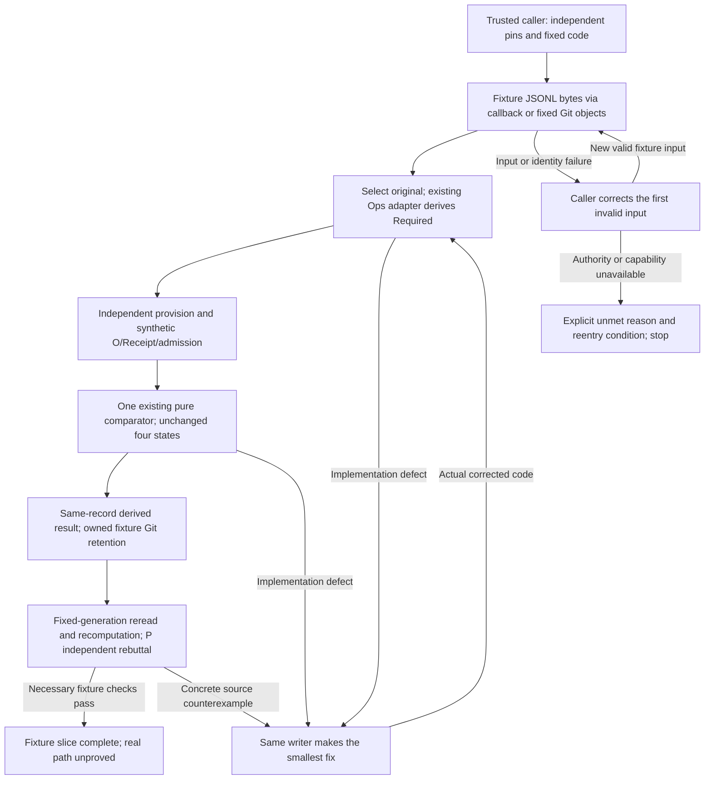
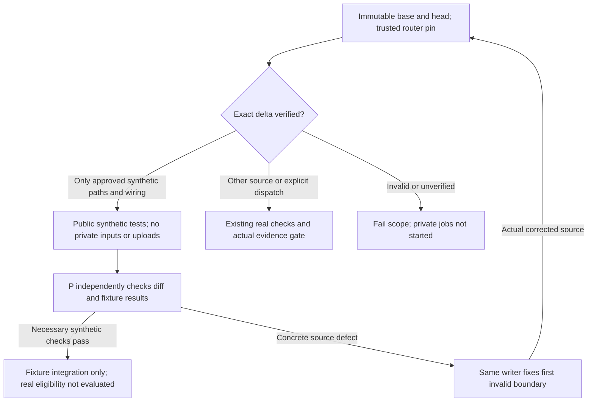

# Contract input boundary: synthetic fixture slice

This slice supplies exact bytes to existing JSONL selection, the existing Ops
Required adapter, and the existing pure contract comparator. It adds two small
readers, not another meaning source, admission mechanism, comparator or service.

The trusted caller supplies source pins independently of the input producer and
chooses the executable adapter/comparator. The existing source-reference fields
remain `repository`, exact `revision`, `path`, and `digest`. A digest, Git-shaped
descriptor, or native object is integrity evidence, not authentication or
admission. Source-root ownership and actual admission remain caller obligations.

`BytesReader` wraps a callback that supplies bytes, source identity and acquisition
completeness. Its readback always says `retained=False`: matching bytes do not
prove a holding ref. `GitObjectReader` reuses the existing Cold native reader,
resolves the literal holding ref once, checks the selected commit/tree, and reads
regular blob bytes at that fixed commit. Its native readback includes the actual
holding ref, holding commit, selected commit/tree, blob and mode. Subsequent file
reads do not resolve the branch again.

`compare_inputs` passes packet and independently pinned admission unchanged to
the same existing comparator. CLOSED/OPEN/INVALID/UNKNOWN and exits 0/2/3/4 remain
that comparator's result. In particular `{}` admission stays UNKNOWN. Input
acquisition errors have an explicit non-PASS status; unexpected programming
exceptions are not converted to completion. No input field can choose validator
code, codec or admission configuration.

## What the fixture actually connects

The test creates only synthetic data in an owned directory below this worktree's
`.artifacts/contract-input-fixtures`. Its finite path is:

1. A synthetic `adr_raw_event.v1` meaning record is retained in fixture Git.
2. An independent source pin selects it through either reader.
3. The existing `tools/package_contract_targets/ops.py::required_contract` derives
   Required from the selected decision/rollout. Independent literal provision and
   expected contract values verify that derivation, rather than copying its output.
4. Synthetic Observation/Receipt and independently configured fixture admission
   feed the existing Ops comparator, loaded from fixed public Ops revision
   `5eb98c82417b399978c1e38aebab5e3fb39752d4`, core blob
   `9613c92deb6ee12b335863a36261268976ad9cc5`.
5. A derived same-record result references the original meaning source, Required
   and candidate. The fixture stores it in another native Git generation and
   rereads that fixed generation. The old inputs are recomputed before comparison.

Those holding refs exist in the owned temporary fixture repository during the
test. Cleanup removes that disposable repository; this is not a claim of durable
production capture or of evidence retained after the test's lifecycle.

The adapter's mandatory `real` receipt-grade string is a **synthetic claimed input
value** in this test, not a real provider execution. The comparator reports fixture
grade and non-authority. This proof creates no actual ADRS admission, execution
Receipt, production Current, operational adoption or real evidence retention.



The fixture also covers altered bytes/source identity, stale candidate, missing
input/admission, partial collections/acquisition, JSON duplicate keys/conflicting
records, invalid UTF-8, path traversal, symlinks, wrong commit/tree, ref expressions,
branch movement, executable-input fields, and rehashed result substitution.
Network socket use and Git fetch/clone/push/ls-remote are forbidden during tests.
Cleanup validates the owned root before removing any recursive fixture directory.

## Local reproduction

Use the existing native Git and Python runtimes. Point
`CONTRACT_INPUT_RUNTIME_ROOT` at the existing **public Ops** fixed read view that
retains the revision above. The runner checks its native core blob before loading
it; it does not fetch dependencies or inspect private ADRS data.

```powershell
$env:CONTRACT_INPUT_GIT = '<existing absolute native git executable>'
$env:CONTRACT_INPUT_RUNTIME_ROOT = '<public Ops fixed read view>'
$env:PYTHONDONTWRITEBYTECODE = '1'
python -m unittest discover -s tools/contract-modeling/tests -p test_contract_input.py -v
python -m unittest discover -s tools/contract-modeling/tests -p test_contract_input_scope.py -v
```

The tests require that explicit runtime source; missing setup fails rather than
silently skipping the consumer proof. Existing Ops comparator regressions can be
run separately from its verified fixed read view. Reader parity is exact equality
of comparator results, while acquisition/retention readbacks intentionally differ.

Local validation on 2026-10-18: all 11 fixture tests passed without skips, including
the existing CLI's four exit states. The unchanged public Ops core/edge suite also
passed all 33 tests without skips. The routing suite passed 16 tests, and all 14
existing Gov release/owner boundary tests passed. These are local synthetic
proofs, not public CI or private real-input validation.

## Exact synthetic CI scope

The existing Normal workflow first compares immutable event base/head commits.
It executes the router from the base object; the first installation instead
checks the candidate router against the exact reviewed bootstrap blob in the
workflow. That bootstrap is a reviewed code pin, not self-admission by input.
Subsequent input cannot choose a different routing policy. The literal allowlist
is only this fixture module, its tests/documentation, and their exact CI wiring.
The workflow wiring must round-trip to unchanged legacy job bytes, apart from
routing and the fixed public Ops runtime checkout/environment needed for tests.
The CI intent delta changes only the description, not admission or the real gate.

Exact fixture-only changes run `synthetic contract input fixtures` using public
Gov and fixed public Ops objects, with no App token, private source checkout or
artifact upload. Real jobs are not run. The skipped gate's conditional name can
appear as an unevaluated expression; the stable real `gate` identity is absent.
The synthetic log explicitly reports `authority=false`, `releaseEligible=false`,
`releaseEligibilityEvaluated=false`, and `realEvidenceNotEvaluated=true`.
GitHub can display skipped jobs as successful checks: neither that display nor
the workflow conclusion establishes release eligibility. The existing real
provider still requires its exact candidate-bound artifact and body evidence.

Mixed/other source changes and explicit dispatch retain the real path. Deletion,
unrelated or missing base, invalid event, changed router policy, or unapproved
workflow/intent edits fail classification rather than activating private jobs.
This does not migrate the legacy real path to private execution or remove its
existing Release/Actions evidence dependencies. No schedule or new workflow is
introduced.



## Publication and claim boundary

This is a fixture-only source slice. Existing source/final/Cold implementations,
admitted meanings, previous finite proofs, and unrelated worktrees remain intact.
It does not make the entire existing Gov final path provider independent: that
path still accepts filesystem bundles and obtains some real evidence through
Release/Actions artifacts. Real evidence-to-native-Git retention and real consumer
binding require separate work and proof.

The initial local fixture proof is complete. The added routing is the bounded
integration change needed before publishing this slice: public PR/merge CI is
still pending independent source review and actual job/artifact readback. Other
Normal scopes can still acquire and upload private ADRS sources, so this is not a
claim that all public CI is safe for real private inputs. A synthetic runner never
stands in for necessary real-data verification. Fixture success is never reported
as a real-data, Git-only, all-provider, whole-foundation or adoption success.
