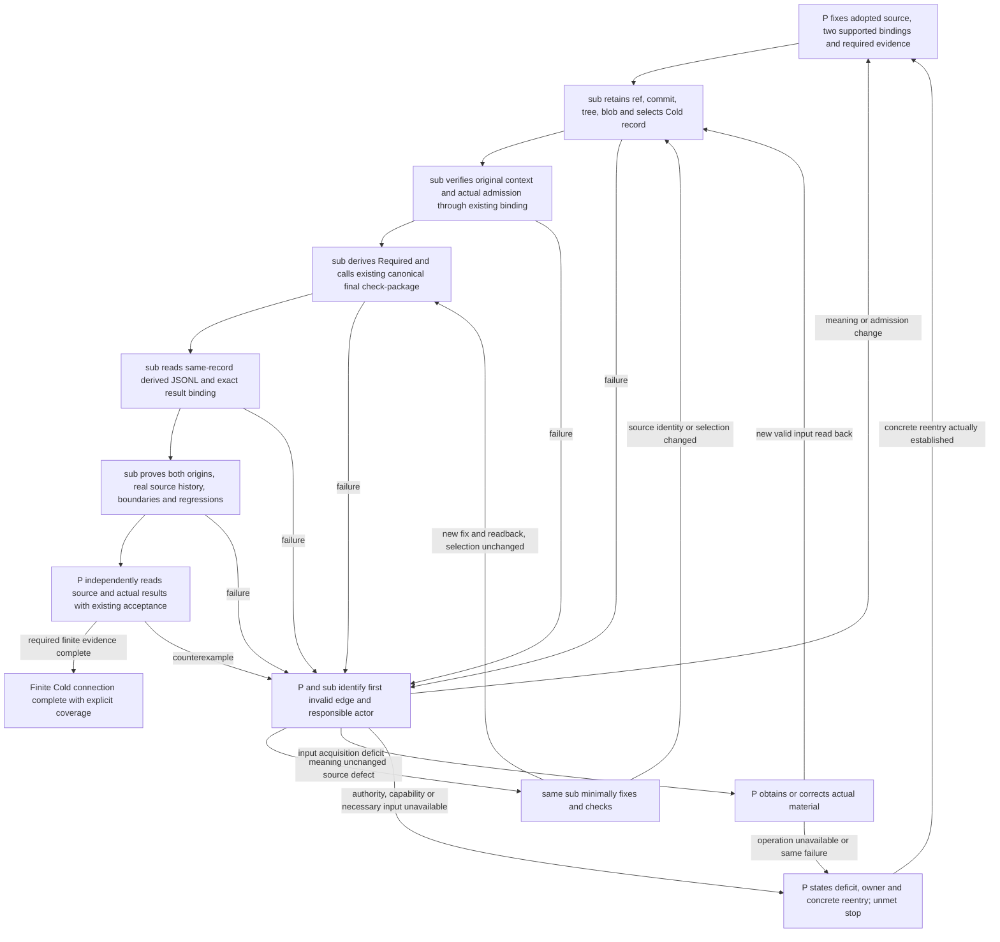

# Recursive contract-modeling admission

This directory implements the deterministic production compiler tracked by
`roccho-dev/governance#153` and specified by accepted `roccho-dev/adrs#234`.

## Accepted authority pin

```text
ADRS_PR=roccho-dev/adrs#241
ADRS_MERGE=458ab4267882083de0593754d1bf9766bf8d54da
DECISION_ID=01K0E1CM000000000000000234
CORRECTION_DECISION_ID=01K0E1CM000000000000000235
DECISION_DIGEST=cc7ac3d6618b31eb0a0979b8aa0e2bfaf6abd95646e45c740d154c8204cd00d1
RELEASE=recursive-contract-modeling-v1.0.1
```

## Boundary

- ADRS owns meaning, purpose, policy, waivers, and cutover decisions.
- Owners submit claims and evidence, not trusted admission results.
- Governance validates, reduces, derives, projects, and reports without meaning authority.
- Ops or the owning repository performs external effects and returns exact-target readback.
- Deprecated spec repositories remain preserved evidence only.

## Data flow

```text
claims
→ closed validation
→ supersession and recursive containment
→ derived eight-way admission
→ promotion-only current epoch
→ DuckDB gates and stable ABI
→ responsibility closure and exact-SHA receipts
```

The production proof includes two unrelated required governance packages, one
bounded model-only package, 36 mapped legacy responsibilities with zero unexplained,
replay equality, query/raw-access enforcement, expected-reason destructive cases,
and immutable Nix store materialization.

## Production cutover

The only blocking provider check remains:

```text
gov-final-scope-purpose-join / gate
```

That gate verifies the accepted ADRS identity, final frozen legacy inventory,
active legacy consumer count zero in the accepted universe, anti-reintroduction,
current package receipts, and the exact governance candidate. Migration completion
becomes true only after the admitted merge is observed by the existing push-only
post-effect readback.

## Run

```text
python3 -m unittest discover -s tools/contract-modeling/tests -p 'test_*.py'
python3 tools/check-contract-modeling-production-migration.py selftest
CANDIDATE_SHA=$(git rev-parse HEAD) bash tools/contract-modeling/run-proof.sh
```

Technical migration closure does not claim all-repository enforcement, business
outcome achievement, or corporate-sale achievement.


## Contract-drift composition and canonical acquisition

The source/fixture stage is merged. Issue #215 adds only the missing bounded
acquisition/normalization path from the existing technical owners; it does not
create a second comparator/compiler, a new semantic registry, or a new ADRS/CUE
adoption prerequisite.

Canonical source pins for this slice are:

```text
ops/proposals  = 27e9c36ead100e033e79b48e2fa94614e93b7a11
envs/proposals = c1a7658f142c82af4ad5cdeba23ee893ef662868
selected DEPLOY = bce3daab76c9a4565902205cc59bb443f6e68009
```

These are distinct identities. The current ops source owns requirement projection; the selected DEPLOY revision identifies the already-reviewed execution tuple. Neither is substituted for the other, and envs `c1a7658...` is not aliased to its older source/review SHAs.

These are merge/canonical identities. They are intentionally not replaced by
the older review-PR heads even when their source trees are byte-equal.

`contract-drift-acquisition` reads the actual ops runtime requirement owner
and the actual envs public contract projection from those pinned sources. The
selected relation is bound only by stable technical row IDs:

```text
binding           = jev-api
consumer_boundary = ops.voice-ui.consumer
```

The obligation key is derived from those stable IDs only. Compared values such
as consumer, stage, capability, provider and target are not used to rediscover
the envs row and are not embedded into K.

The selected K/U/profile is derived **before R acquisition** from the existing
runtime requirement constants, the stable technical selector and the target
validated by the existing ops runtime target validator. The semantic digest is
therefore fixed before the requirement row exists. That digest is then passed
to the existing ops requirement generator and to the existing envs stable-ID
selector. A missing/empty R cannot erase U or vacuously close coverage.
The normalized R/P packet is passed to the existing
`bin/contract_drift_phase2.py::compose()`, which invokes the one pinned ops
`contract-diff` implementation.

Production acquisition is exposed only through the Nix-built
`contract-drift-acquire` entry. Nix generates its Python runner with literal
ops/envs store roots, exact canonical revisions and the selected DEPLOY revision;
callers cannot supply or override those values. The checked-in Python CLI exposes
only `acquire-fixture` for direct acquisition, and that path always emits
fixture-grade composition. There is no checked-in raw source-grade acquisition
subcommand.

A source-grade target is never accepted as raw target JSON. Production accepts
an optional closed `governance.voiceUiApprovedTargetSelection.v1` packet only
when its exact packet bytes match an independently admitted digest and it binds:

```text
selected_deploy_revision = bce3daab76c9a4565902205cc59bb443f6e68009
envs_revision            = c1a7658f142c82af4ad5cdeba23ee893ef662868
source                    = exact repository/revision/path/content-digest identity
target_digest             = canonical sha256(target)
target                    = closed Workers target validated by the canonical ops contract
```

If that provenance-bearing target input is absent, acquisition is `UNKNOWN`;
shape-valid fixture/invented target JSON cannot enter the production source-grade
path.

Already-produced observations and receipts may be supplied as closed normalized
packets together with an admitted `receipt id -> sha256(receipt)` map. The
acquisition layer performs no provider effect. Missing O/H remains
`EVIDENCE_MISSING`; incomplete or unadmitted evidence provenance becomes
`UNKNOWN`; admitted but mismatched attempt/epoch/source/target/slot/grade remains
typed `EVIDENCE_DRIFT` in the existing ops comparator. A valid admitted H can
remove `EVIDENCE_MISSING` without hiding independent contract drift.

The source-level O/H inventory is empty unless real observations/receipts are
provided by their own later boundary. Therefore missing required evidence
remains `EVIDENCE_MISSING`; file/name presence is never promoted to real proof.
If the approved Workers target input is unavailable, acquisition returns
`UNKNOWN` and does not invent account/Worker identity from the current Pages
provision.

The acquisition selftest fixes these failure classes against the canonical
source bytes:

- selected relation with missing R cannot vacuously close;
- Workers expectation + current Pages provision is typed target drift;
- stage/consumer/capability drift keeps the same K and never becomes supply loss;
- true stable-relation absence becomes `SUPPLY_MISSING`;
- required evidence absence remains `EVIDENCE_MISSING`;
- unavailable approved target is `UNKNOWN`;
- raw fixture target cannot mint production source-grade acquisition;
- source root/revision is fixed by the Nix production wrapper;
- source identity mismatch is rejected;
- closed O/H intake removes `EVIDENCE_MISSING` only with admitted receipt digest provenance;
- untrusted evidence is `UNKNOWN`, while attempt/source/target mismatches remain typed drift;
- identical exact inputs replay byte-identically;
- candidate/source labels never set final admission;
- #543/#544, new ADRS/CUE source families, workflow revival and provider effects
  are not inputs to this bounded composition.

The legacy `contract-drift-phase2` V24-V28 selftest is retained. Both checks
are non-authoritative and effect-free. Existing governance gates still own final
grade/residual/closure. The separate live-selected-consumer Red and ADRS #443
real provider/readback/application-acceptance work remain required overall and
are not hidden by this source check.

## Fixed Cold record to the same contract result

This slice starts at the **existing Git Cold JSONL recording path**. It adds no
recording API, Hot reader, admission writer, meaning ledger, comparator or Atlas
requirement. The existing package-contract entry has one additional command,
`cold-check`, which selects a fixed Cold record and returns its derived result.
The record's `Accepted` label, file presence or a caller flag never grants
admission. The existing target binding must lead back to the actual adopted
original and its native Git bytes.

The common selector takes a holding ref, exact commit, path and immutable record
ID, with an optional preserved-original object ID. It handles the existing direct
JSONL object and `source_content` preservation formats using the existing ADRS
materializer. Record IDs, package names and source paths do not dispatch product
code. Its executable codec is separately pinned to ADRS
`a6284e58ed99243447e135828d983fc07d2d363e:tools/materialize.py`, Git blob
`f861d0019667ee679da3d374dac8e117adae05d0`; a selected Cold data revision cannot
provide executable transform code.

The supported meaning/admission families remain the existing two target bindings,
not arbitrary Cold kinds or all obligations in a record. The finite proof inputs
are independently selected from those bindings:

| Input | Actual adopted source | Existing consumer scope |
| --- | --- | --- |
| Apps direct Requirement JSONL | ADRS PR642 merge `862313008ad19a743034599792d9a8b6e470e4cf` | Apps artifact declaration and exact build projection |
| Preserved CI-topology contract | ADRS PR233 merge `a8fc9e8e04d53f1d783317059e4421c8dc724d01`, equal to the preserved original at `97335ac08a0be2d759703b426a3183c43ee8b6a1` | Ops self-diff consumed, not organization admission |

Neither observed target enumeration nor a new caller-supplied admission file
defines the required universe. The source's raw digest, canonical meaning digest
and derived obligation digest retain their distinct roles. Required is derived
from the trusted accepted source; Provided remains the Repo's declaration;
Observation and Receipt remain evidence of the actual candidate and operation.
`cold-check` calls the existing final **`check-package`** entry, which loads the
corrected canonical checker, import guards, full material/body verification,
comparator replay and required negative checks. It does not bypass these through
the lower verifier, and it does not claim a new full-organization/current-provider
final, release or operational adoption.

The returned `adr_raw_event.v1` Fact is a disposable, non-authoritative result
projection. It references the selected record with its fixed repository,
commit/tree/blob/path, actual adopted source, target/candidate, obligation,
transform identity and actual consumer report. Its coverage is explicitly the
selected binding. Missing/unverified inputs return `UNKNOWN` with incomplete
coverage; malformed/conflicting input returns `INVALID`. The existing comparator's
`CLOSED/OPEN/INVALID/UNKNOWN` and exit `0/2/3/4` are preserved; the Cold selector
does not invent an OPEN bundle or turn an unverified input into a closed member.
`--cold-result` first recomputes the result and compares the entire stored record;
changing a stored result and rehashing it does not replace recomputation.

### Execution and failure closure



The diagram describes execution responsibilities, not a promise that drawing an
edge makes its operation available. Existing successful evidence is reused where
it meets the same-version condition; old successful CI is not rerun merely to
populate this graph. Meaning changes return to P to refix the expected contract.
Meaning-invariant source corrections remain with the same implementation actor.
They do not wait for a fresh P instruction on each ordinary failure. Only checks
affected by the new fix are repeated at D/E/T; unchanged source acquisition and
successful unrelated checks are reused. Meaning or authority changes require P's
decision before execution.

### Reproduce

Run through the canonical entry, supplying the same native source roots and
evidence material required by its existing `check`/`check-package` commands:

```text
python3 tools/check-package-contract-closure-bundle.py cold-check \
  --target-id TARGET --bundle BUNDLE --target-source TARGET_ROOT \
  --accepted-requirement-source ACCEPTED_ROOT --governance-policy-source POLICY_ROOT \
  --contract-runtime-source RUNTIME_ROOT --evidence-input EVIDENCE_ROOT \
  --governance-candidate GOVERNANCE_SHA \
  --cold-source ADRS_NATIVE_ROOT --cold-code-source TRUSTED_CODEC_NATIVE_ROOT \
  --cold-ref HEAD --cold-revision COLD_SHA \
  --cold-path decisions/RECORDS.jsonl --cold-record-id RAW_ID --out RESULT.jsonl
```

On Windows `--git-executable` must name the absolute existing native Git program.
Native roots must have the exact heads required by the existing bindings. A
retained commit is checked against a literal holding ref; `refs/...~0` and reflog
expressions are not holding refs. Source paths must be regular native blobs, not
symlinks or traversal paths. An explicitly supplied `--target-candidate` must
equal the trusted binding's candidate.

```text
python3 tools/contract-modeling/tests/test_cold_contract_input.py -v
```

Always-on native boundary tests need no network. The real proof uses
`COLD_INPUT_PROOF_CONFIG`, a JSON file containing **location arguments only** for
the existing two target source/bundle/evidence roots and fixed Cold source.
It contains no admission overrides. `COLD_INPUT_PROOF_OUTPUT` retains the actual
derived records and test counts. The existing phase4 CI supplies these locations,
requires both targets and zero skipped tests, and transports the result with its
ordinary evidence artifact. Its exact stacked base is Gov220 head
`3b9246ff1b4bb0211508213ac714ab460f3801dc`; prior Gov/Ops/Apps source and finite
acceptance remain preserved.

The tests include a real historical boundary: the actual first parent of PR642,
`896851b2e21451d2f5d4999f6687a6be387a747c`, lacks this Requirement and cannot reuse
the later CLOSED packet; the adopted source can. This does not claim arbitrary
purpose edits or new adoption. A synthetic unadmitted preservation delta separately
proves that another immutable record ID can reference the same original without
changing Required, and that a proposal cannot admit itself. Synthetic boundary
inputs are not actual adopted meaning.

Local Windows evidence is reported separately from Linux CI: the unchanged Ops
receipt producer writes native newlines, so its exact Linux-byte replay is skipped
on Windows and remains required in phase4 CI. No old source or original packet is
normalized to force a local pass. Fixed historical source/build proof and current
retrieval are not promoted to present operational fitness or timeless freshness.
